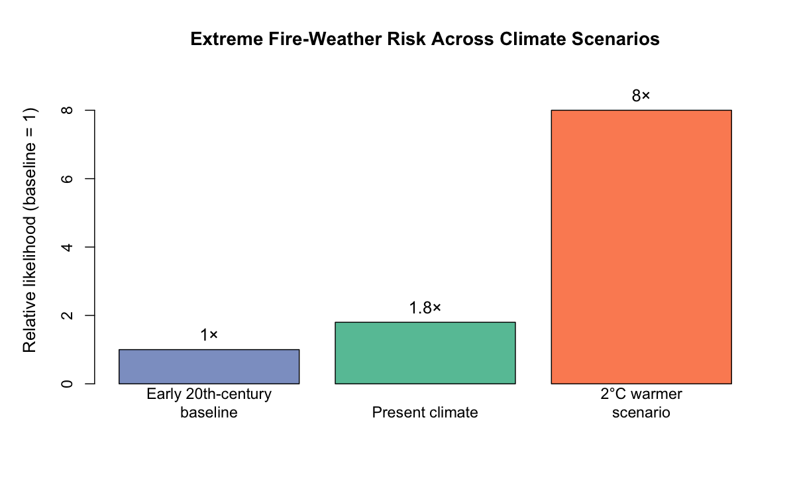

# Why Does Changing Fire Weather Matter?

The devastating 2019–20 Australian bushfire season raised an important question: how is climate change affecting the likelihood of extreme fire-weather conditions?

For local governments and emergency management professionals, this is more than a scientific question. Understanding how climate risk changes can help inform long-term preparedness and resilience planning.

In this post, I summarise research by van Oldenborgh et al. (2021) on the influence of anthropogenic climate change on extreme fire-weather risk in southeastern Australia.

## What Did the Research Find?

The study found that anthropogenic climate change increased the likelihood of extreme fire-weather conditions. Climate-model results estimated that an event with a Fire Weather Index (FWI) as high as that observed in 2019–20 was approximately 80% more likely than in the early twentieth-century climate. The conservative lower bound was approximately 30%. The estimated change in risk is shown in the figure below. The comparison shows why historical fire-weather probabilities may no longer provide a sufficient guide to future preparedness.

{#fig-fwi-risk} The present-climate estimate is approximately 1.8 times the baseline likelihood, with a conservative lower bound of about a 30% increase. Under a 2°C warmer climate, the estimated likelihood is approximately eight times the baseline, with a lower bound of about four times. The future estimate is uncertain because only two climate models were available for that analysis.

## Which Factors Matter for Fire Weather?

Table 1 summarises the main findings across the climate factors examined in the study. The results show that the evidence for an anthropogenic signal differs across factors.

| Factor | Main finding | Interpretation |
|----|----|----|
| Extreme fire weather | Approximately 80% more likely in the present climate; conservative lower bound about 30% | Clear increase in weather-related risk |
| Extreme heat | At least twice as likely | Rising temperature extremes are a major driver |
| Extreme annual drought | No attributable trend identified | The study did not find the same signal across all climate variables |
| Natural climate variability | IOD and SAM contributed to the 2019 drought conditions | Individual fire seasons are also influenced by natural variability |

: Summary of climate factors examined in van Oldenborgh et al. (2021). {#tbl-climate-factors}

As shown in @tbl-climate-factors, climate change does not affect every component of fire weather in the same way. This distinction matters when communicating risk to emergency planners.

## What Are the Limitations?

These findings should be interpreted with care. The study estimates changes in the likelihood of extreme fire-weather conditions, rather than attributing every aspect of the 2019–20 bushfire disaster to climate change. Ignition sources, vegetation, exposure and vulnerability also influence bushfire impacts.

The future estimate under approximately 2°C warming is particularly uncertain because it was based on only two climate models. The results therefore indicate a direction of changing risk, rather than an exact prediction of future fire seasons.

## Conclusion

The evidence from van Oldenborgh et al. (2021) indicates that anthropogenic climate change has increased the likelihood of extreme fire-weather conditions in southeastern Australia. The model-based estimate suggests that a 2019–20-level event became approximately 80% more likely than in the early twentieth-century climate, although the conservative lower bound was about 30%.

For local governments and emergency management professionals, the key implication is that historical fire-weather probabilities should not automatically be treated as reliable guides to future conditions. Climate adaptation and bushfire preparedness need to account for changing climate risks while also considering natural variability and the non-climate factors that shape fire impacts.

## Reference

van Oldenborgh, G. J., et al. (2021). Attribution of the Australian bushfire risk to anthropogenic climate change. *Natural Hazards and Earth System Sciences, 21*, 941–960. <https://doi.org/10.5194/nhess-21-941-2021>
